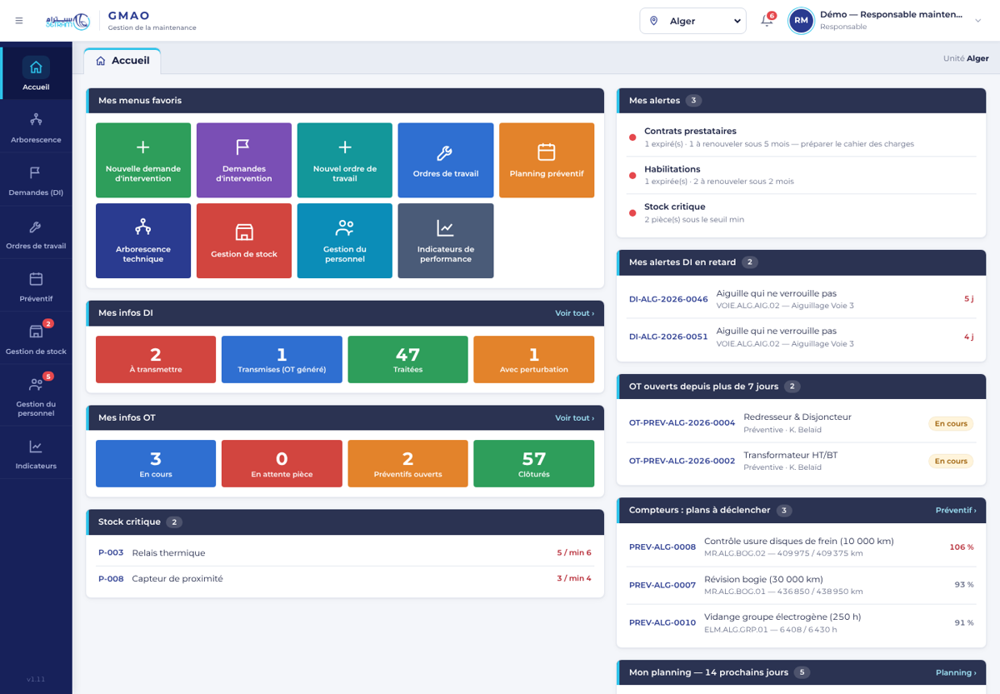
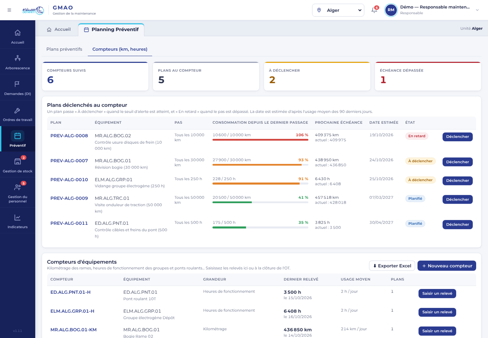
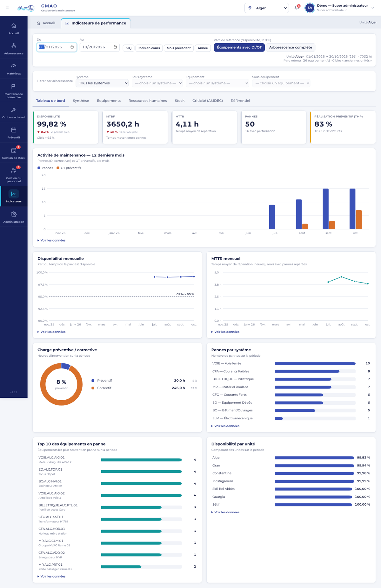

# GMAO SETRAM — Guide utilisateur

**Version de l'application : 1.13** · Public : agents d'exploitation, techniciens, chargés et responsables de maintenance, magasiniers, direction, administrateurs

Ce guide explique comment utiliser la GMAO au quotidien. Chaque utilisateur ne voit que les modules et les unités ouverts par l'administrateur : si un écran décrit ici n'apparaît pas pour vous, c'est que vos droits ne le prévoient pas.

---

## 1. Se connecter

1. Ouvrez l'adresse communiquée par la DSI (par exemple `https://gmao.setram.local`) dans **Chrome, Edge ou Firefox**, sur ordinateur, tablette ou téléphone.
2. Saisissez votre **identifiant** et votre **mot de passe**.
3. À la **première connexion**, ou après une réinitialisation, l'application exige un **nouveau mot de passe** : 10 caractères minimum, avec au moins une lettre et un chiffre.

> Après **5 erreurs de mot de passe**, le compte est **verrouillé quelques minutes**. Patientez, puis réessayez. En cas d'oubli, demandez une réinitialisation à l'administrateur : personne, pas même lui, ne peut lire votre mot de passe.

Pensez à **vous déconnecter** sur un poste partagé (menu profil, en haut à droite). La session expire automatiquement après 8 heures.

---

## 2. L'écran

| Zone | Rôle |
|---|---|
| **Menu à gauche** (icônes) | Accès aux modules : Accueil, Arborescence, Matériaux, Maintenance corrective (DI et OT correctifs), Ordres de travail (OT préventifs), Préventif, Gestion de stock, Gestion du personnel, Indicateurs, Administration. Une pastille rouge signale des éléments à traiter |
| **En-tête** | Logo (retour à l'accueil), **choix de l'unité** (Alger, Oran…), **cloche des alertes**, menu **profil / déconnexion** |
| **Bandeau d'onglets** | Rappelle le module ouvert ; « Accueil » permet d'y revenir à tout moment |
| **Accueil** | Tableau de bord : menus favoris, compteurs DI et OT, alertes, DI en retard, OT anciens, plans au compteur à déclencher, planning des 14 prochains jours, stock critique |

Sur téléphone, le menu s'ouvre avec le bouton **☰** en haut à gauche ; l'unité se choisit en haut du menu.

**Les modifications sont enregistrées automatiquement** sur le serveur ; les changements faits par vos collègues apparaissent sans recharger la page (toutes les 15 secondes environ).

---

## 3. Qui fait quoi

| Profil | Modules habituels | Tâches principales |
|---|---|---|
| **Exploitation** (conducteur, régulation, chef de station) | Demandes (DI) | Déclarer les anomalies |
| **Technicien** | Ordres de travail, Préventif (selon droits) | Réaliser les OT, renseigner le compte-rendu, saisir les relevés de compteur |
| **Chargé / Responsable maintenance** | DI, OT, Préventif, Personnel, Indicateurs | Transformer les DI en OT, planifier le préventif, affecter les intervenants, suivre les indicateurs |
| **Magasinier** | Gestion de stock | Traiter les demandes de sortie, réceptionner, suivre les seuils |
| **Direction** | Indicateurs | Suivre la performance (MTBF, MTTR, disponibilité…) |
| **Administrateur** | Administration | Comptes, droits, import de données |

Les droits sont donnés **par unité, par système** (CFO, CFA, VOIE, BILLETTIQUE, MR, ELM, BO, ED) **et par module** : un technicien CFO d'Alger ne voit ni les équipements MR, ni les données d'Oran.

---

## 4. Exploitation — déclarer une anomalie (DI)

**Depuis l'ordinateur ou le téléphone :** *Maintenance corrective* › onglet *Demandes d'intervention (DI)* › **Nouvelle DI** (ou la tuile verte de l'accueil).

1. Choisissez l'**équipement** (liste limitée à votre unité et vos systèmes).
2. Décrivez le **constat** (désignation), l'**emplacement**, la **date et l'heure de l'événement**.
3. Indiquez s'il y a **perturbation de l'exploitation**.
4. **Créer la DI** : le numéro est attribué par le serveur (ex. `DI-ALG-2026-0042`), jamais deux fois le même.
5. Ajoutez des **photos** depuis la fiche de la DI (« Prendre une photo » sur téléphone).

**Par QR code :** scannez l'étiquette collée sur l'équipement avec l'appareil photo du téléphone ; la GMAO s'ouvre directement sur « Nouvelle DI » pour cet équipement.

**Suivi :** une DI passe de **À transmettre** → **Transmis** (un OT a été généré) → **Traité** (l'OT est clôturé).

---

## 5. Maintenance — Ordres de Travail (OT)

### Générer un OT
- **Correctif** : dans la liste des DI, bouton **Générer OT** sur une DI « À transmettre ». Renseignez la consigne, les intervenants, l'horaire (jour / nuit) et la consignation si nécessaire.
- **Préventif** : généré depuis un plan (§ 6) ; il contient la liste des tâches du plan.
- **Hors DI** : *Ordres de travail* › **Nouvel OT** (OT préventif).

Les **OT correctifs** se consultent dans *Maintenance corrective* › onglet *OT correctifs* ; le module *Ordres de travail* ne contient que les **OT préventifs**.

### Réaliser et clôturer un OT
Ouvrez l'OT (clic sur la ligne, ou toucher la carte sur téléphone) :

1. **Tâches** (préventif) : cochez chaque tâche **OK** ou **Non OK**. Un « Non OK » exige un commentaire et le choix de créer ou non une **DI corrective** automatiquement.
2. **Compte-rendu** (correctif) : panne, cause, solution, **détection** et **gravité** (1 à 4), durée d'intervention, temps logistique.
3. **Intervenants** : ajoutez chaque intervenant et son temps passé (le coût de main-d'œuvre est calculé).
4. **Pièces, outillage, consommables** : une pièce se demande par une **DS** (demande de sortie). Dès qu'une DS est faite, l'OT passe **En attente pièce** et **ne peut pas être clôturé** tant que le magasin n'a pas traité la sortie (BS traité) ou que la DS n'est pas annulée. Il repasse « En cours » quand toutes ses DS sont soldées.
5. **Relevé du compteur** : si l'OT vient d'un plan au compteur, la valeur lue (km, heures) est **obligatoire** pour clôturer (§ 6.3).
6. **Clôturer** : possible seulement si toutes les tâches sont renseignées et au moins un intervenant saisi.

**Imprimer / PDF** : bouton en haut de l'OT, pour un bon papier à emporter sur le terrain (lignes vides à remplir à la main).

---

## 6. Préventif

### 6.1 Plans au calendrier
*Préventif* › **Nouveau plan** : système, équipement, **périodicité** (hebdomadaire à annuelle) ou **période avec intervalle** (tous les N jours / semaines / mois), prochaine échéance, intervenants, tâches, outillage et consommables.

- Une échéance un **jour férié ou un week-end** est signalée : changez la date ou confirmez un travail exceptionnel avec son motif.
- Un intervenant **en congé** à la date prévue est refusé, et une alerte apparaît si un congé est saisi après coup.
- Le filtre **Intervenant** (en haut à droite) n'affiche que les plans assignés à une personne, y compris dans l'agenda, la plage de déclenchement et les plans au compteur.
- **Déclencher** génère l'OT préventif ; **Plage de déclenchement** permet de générer en une fois toutes les visites d'une période ; **Calendrier / Agenda** affiche le mois ; la liste **Vue** propose aussi **Jour** (feuille de route détaillée de la journée, imprimable) et **Année complète**, qui affiche toute l'année (une ligne par plan, une colonne par mois, total des visites par mois, export Excel).

### 6.2 Compteurs d'équipement

*Préventif* › onglet **Compteurs (km, heures)** :
- **Nouveau compteur** : équipement, grandeur (kilométrage, heures de fonctionnement, cycles), valeur initiale.
- **Saisir un relevé** : valeur lue et date. La GMAO **refuse** une valeur inférieure au dernier relevé ou une date future. En cas de **remplacement du compteur**, cochez la case et indiquez la dernière valeur de l'ancien compteur : le cumul est conservé.
- L'**usage moyen par jour** est calculé sur les 90 derniers jours.

### 6.3 Plans au compteur
Dans le formulaire de plan, choisissez **Déclenchement : Compteur**, puis le compteur, le **pas** (ex. 30 000 km), le **seuil d'alerte** (90 % par défaut) et la valeur au dernier passage.

| État | Signification |
|---|---|
| **Planifié** | Moins de 90 % du pas consommé |
| **À déclencher** | Seuil d'alerte atteint : préparez l'intervention |
| **En retard** | Pas dépassé |

La **date estimée** est calculée d'après l'usage moyen. À la clôture de l'OT, le relevé saisi **remet le cycle à zéro**.

---

## 7. Gestion de stock

| Document | Usage |
|---|---|
| **Article** | Pièce, outillage ou consommable : prix, stock, seuils min / max, fournisseurs |
| **DS** — demande de sortie | Faite depuis un OT : **une seule DS pour toutes les pièces** (bouton « Créer une DS globale ») ; « Transmis au Magasinier » si le stock suffit, sinon « En attente pièce » |
| **BS** — bon de sortie | Généré par le magasinier depuis la DS ; son traitement **décrémente le stock** et débloque l'OT |
| **BR** — bon de retour | Retour d'une pièce non utilisée : **réincrémente le stock** |
| **Achat** | Entrée en stock d'un article existant |
| **Décharge** | Remise d'outillage ou de consommable à un agent |

Un article **sous le seuil minimum** apparaît en rouge, sur l'accueil et dans les alertes.

**DS globale.** Dans l'OT, le bouton **« Créer une DS globale — 3 pièces »** ouvre une seule demande avec toutes les pièces de l'OT (pour un OT préventif : les pièces prévues par le plan). Dans le formulaire, ✕ retire une ligne, « + Ajouter une pièce » en ajoute une. Si une seule pièce manque en stock, la DS part « En attente pièce ».

**Retirer une pièce d'une DS.** *Gestion de stock › Demandes de Sortie* : tant que le bon de sortie n'est pas généré, ✕ à côté d'une pièce la retire de la DS (l'état est recalculé ; retirer la dernière pièce annule la DS). Le bon de sortie reprend ensuite toutes les pièces restantes.

---

## 8. Gestion du personnel

- **Intervenants** : poste, système, taux horaire, **congés**, **habilitations** avec date et validité. Les habilitations **expirées** ou à renouveler sous 2 mois sont signalées.
- **Prestataires** : systèmes couverts, **dates de contrat**, état du cahier des charges. Un contrat à renouveler sous 5 mois est signalé pour préparer la consultation.
- **Jours fériés** : utilisés pour les contrôles de planning.

---

## 9. Indicateurs de performance

Choisissez la **période** et, si besoin, un **système**, sous-système ou équipement.

| Onglet | Contenu |
|---|---|
| **Tableau de bord** | Chiffres clés (avec variation par rapport à la période précédente) et graphiques : activité sur 12 mois, disponibilité et MTTR mensuels, charge préventive / corrective, pannes par système, top 10 des équipements, comparatif des unités. Survolez un graphe pour lire les valeurs ; « Voir les données » affiche le tableau |
| Synthèse | MTTR, MTBF, disponibilité, λ, μ, charges préventive et corrective, taux de réalisation |
| Équipements | Indicateurs par équipement, seuil d'OT réglable pour repérer les équipements à problème |
| Ressources humaines | Temps saisi par intervenant |
| Stock | Valeur, ruptures, consommation |
| Criticité (AMDEC) | Gravité × probabilité × non-détection |
| Référentiel | Définition et formule de chaque indicateur |

**Historique :** pour rester rapide, l'application ne charge pas les DI et OT **clos depuis plus de 24 mois**. Si la période choisie commence avant, un bandeau propose **Charger l'historique complet**.

Chaque écran a un bouton **Exporter Excel**.

---

## 10. Arborescence technique et matériaux

- **Codification** : `SYSTÈME.UNITÉ.SOUS-SYSTÈME.N°`, par exemple `CFA.ALG.SLT.01`.
- Les appareils de mesure, contrôles réglementaires et organismes sont dans le module **Gestion et suivi des matériaux**.
- **Clic** sur un équipement : fiche (caractéristiques, constructeur, fournisseurs, sous-équipements). **Clic droit** : créer une DI.
- **Étiquettes QR** : planche imprimable des QR codes de l'unité, à coller sur les équipements.

---

## 11. Administration (super administrateur)

- **Comptes et droits d'accès** : pour chaque unité, cochez les **systèmes** et les **modules** autorisés, et éventuellement les indicateurs visibles. Désactiver un compte coupe sa session immédiatement.
- **Import de données (Excel)** : téléchargez le modèle Excel, remplissez-le, chargez-le : chaque ligne est contrôlée et les erreurs sont listées avant tout envoi. Limites : 100 000 lignes par feuille, fichier de 50 Mo ; au-delà, découpez par unité ou par système et importez les fichiers l'un après l'autre. L'import n'est possible que sans erreur, et il est **tout ou rien** : rien n'est enregistré si le serveur refuse une ligne. Le réimporter ne crée pas de doublon.
  - **Équipements et sous-équipements en une seule fois** : dans la feuille *Équipements*, donnez un **Repère** court (T1, R02…) aux équipements qui ont des composants ; dans la feuille *Sous-équipements*, indiquez ce repère comme *Équipement parent*. Les codes GMAO sont créés automatiquement pour les deux. Pour un équipement déjà dans la GMAO, indiquez directement son code.
  - **Planning préventif avec les FMP** : remplissez la feuille *Planning préventif* (Code GMAO, Type de visite, lien vers la FMP, outillage…), puis, à l'étape **« Fiches FMP »** de l'écran d'import, ajoutez les fichiers FMP ou un dossier. **FMP rangées par système** : choisissez le dossier qui contient tous les dossiers de système (les sous-dossiers sont lus), ou ajoutez chaque dossier l'un après l'autre. Une fiche portant le même nom dans deux systèmes est retrouvée grâce au chemin du lien. Les tâches de chaque visite sont lues dans la FMP ; les intervenants sont répartis automatiquement entre les techniciens du système (hors congés) et restent modifiables dans chaque plan. Le lien de la FMP est conservé et affiché dans le plan, l'OT et le bon imprimé.
- **Repartir de zéro** (mise en service) : vide toutes les données (équipements, DI, OT, plans, compteurs, magasin, personnel, matériaux ; systèmes et arborescence seulement si vous cochez l'option) pour importer ensuite les vôtres. Les comptes et le journal d'audit sont conservés. **Faites d'abord une sauvegarde** (DSI) ; cochez la case, recopiez « REPARTIR DE ZERO », puis « Vider les données ». Rien n'est effacé physiquement : la DSI peut annuler l'opération. Ordre conseillé ensuite : systèmes / arborescence → équipements et sous-équipements → articles → intervenants → planning préventif.

---

## Supprimer une fiche

**Créée par erreur ?** Le plus rapide : dans l'*Arborescence*, l'icône ✕ au bout de la ligne de l'équipement (ou du sous-équipement) ; dans *Gestion et suivi des matériaux*, le bouton **✕ Supprimer** au bout de la ligne (appareil de mesure, contrôle réglementaire, organisme). Il reste à confirmer par « Oui, supprimer ».

Ouvrez la fiche (équipement, DI, OT, plan, article, intervenant…) : le bouton **Supprimer** est en bas. Une confirmation est demandée. Si l'élément est encore utilisé ailleurs (par exemple un équipement qui a des DI, un intervenant assigné à des plans), le bouton est grisé et la raison est indiquée : traitez d'abord ces liens. Un OT clôturé ne se supprime pas (il fait partie de l'historique des indicateurs). La suppression est enregistrée dans le journal d'audit.

## 12. Questions fréquentes

| Situation | Que faire |
|---|---|
| « … a été modifié par un autre utilisateur » | Un collègue a modifié la même fiche en même temps. Vos changements n'ont pas été enregistrés et la fiche a été actualisée : refaites votre modification |
| Je ne vois pas une unité ou un module | Vos droits ne le prévoient pas : demandez à l'administrateur |
| « Impossible de joindre le serveur » | Vérifiez le réseau, puis **Réessayer**. Ne fermez pas l'onglet si des modifications sont en attente (le navigateur vous prévient) |
| L'OT ne se clôture pas | Lisez le message : tâche non renseignée, intervenant manquant, DS non traitée par le magasin ou relevé de compteur manquant |
| Les indicateurs semblent incomplets sur une longue période | Cliquez sur **Charger l'historique complet** |

---

## 13. Glossaire

| Terme | Définition |
|---|---|
| **DI** | Demande d'intervention : signalement d'une anomalie par l'exploitation |
| **OT** | Ordre de travail : intervention de maintenance, corrective ou préventive |
| **DS / BS / BR** | Demande de sortie / Bon de sortie / Bon de retour (magasin) |
| **MTBF** | Temps moyen entre pannes (fiabilité) |
| **MTTR** | Temps moyen de réparation (maintenabilité) |
| **λ / μ** | Taux de panne (1/MTBF) / taux de réparation (1/MTTR) |
| **AMDEC** | Analyse des modes de défaillance, de leurs effets et de leur criticité |
| **ED** | Équipement dépôt (pont roulant, tour en fosse, machine à laver…) |
| **Pas** | Intervalle d'un plan au compteur (ex. tous les 30 000 km) |
